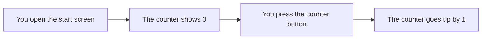
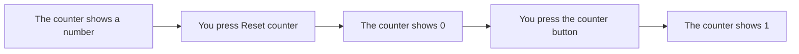

# Counter

The start screen shows a counter. Anyone who opens the start screen can use it to count, and in some installations also to reset the count to zero.

## Count

The counter starts at 0 each time you open the start screen. Each press of the counter button adds 1.

## Reset the count

Next to the counter there is a **Reset counter** button. Press it to set the count back to 0 at once. You can then count up again from 0. If the count is already 0, it stays at 0.

The reset button is only available where it has been enabled. If you don't see it, counting still works as described above.

